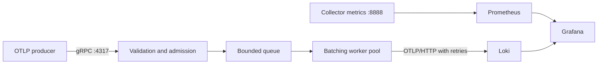

# Distributed Telemetry Collector

A Go collector for OpenTelemetry logs, built to study concurrency, backpressure,
and failure handling. Phase 1 runs as a single instance and uses memory for
buffering. The next phase adds a custom write-ahead log and crash recovery.



## Run the full stack

Requirements: Docker Desktop with Compose. Native Go development uses Go 1.26.2.
The receiver uses official generated OTLP protocol packages; `protoc` and Buf
are not required to build this project.

```sh
make up
# Wait for Loki to report ready; initial startup can take about 30 seconds.
curl http://localhost:3100/ready
docker compose run --rm producer
```

The producer sends 100 logs through the collector. Open:

| Service | Address |
| --- | --- |
| Grafana dashboard | http://localhost:3000/d/telemetry-collector |
| Prometheus | http://localhost:9090 |
| Collector metrics | http://localhost:8888/metrics |
| Collector readiness | http://localhost:8888/readyz |
| Loki readiness | http://localhost:3100/ready |

Grafana has a provisioned dashboard and Loki/Prometheus data sources. Anonymous
viewing is enabled for local development; the optional admin login is `admin` /
`admin`. All published ports bind to localhost. Use Grafana Explore with the
Loki query `{service_name="telemetry-demo"}` to find sample logs.

To customize host ports or the Grafana admin password, copy `.env.example` to
`.env` before starting the stack. To generate more traffic:

```sh
docker compose run --rm producer -endpoint collector:4317 -count 10000 -batch 100 -interval 10ms
docker compose logs -f collector
make down
```

`make down` preserves named volumes. `docker compose down -v` deletes local
Loki, Prometheus, and Grafana data.

## Native development

Run Loki in Docker and the collector/producer on the host. Stop the full stack
first if its collector already occupies ports 4317 and 8888.

```sh
docker compose up -d loki
go mod download
make run
# In another terminal:
make produce
```

`make build` writes both executables under `bin/`. Enable local pprof endpoints
with `ENABLE_PPROF=true make run`; profile at
`http://localhost:8888/debug/pprof/`. If Docker cannot reach its engine, check
`docker context show` and select `docker context use desktop-linux`.

## Delivery and resource behavior

- A successful OTLP response means the request was admitted into memory. It
  does not mean Loki has received it, and a crash can lose accepted logs.
- The queue bounds waiting requests. A separate byte budget covers queued and
  in-flight requests, including batching and retries. It measures encoded
  protobuf bytes, rather than Go heap usage; decoding, protobuf objects, and
  serialization buffers require additional memory.
- Full capacity returns `RESOURCE_EXHAUSTED` with `RetryInfo`. Invalid record
  limits/IDs return `INVALID_ARGUMENT`. The gRPC receive byte limit is enforced
  before the handler and returns `RESOURCE_EXHAUSTED` without retry advice.
- Workers combine up to `BATCH_SIZE` requests, flushing after `BATCH_WAIT`.
  A batch can contain at most `BATCH_SIZE * MAX_RECORDS_PER_REQUEST` records
  and approximately `BATCH_SIZE * MAX_REQUEST_BYTES` encoded bytes.
- Each failed HTTP attempt is counted. Transport errors and HTTP 429, 502,
  503, and 504 receive bounded exponential backoff with jitter. `Retry-After`
  is honored up to `RETRY_MAX`. Each attempt has an `EXPORT_TIMEOUT`.
  The exporter accepts standard OTLP HTTP 200 responses and Loki's HTTP 204
  full-success response.
- Permanent failures or exhausted retries drop the batch and increment
  `collector_dropped_total`. Partial downstream success is final: rejected
  records are counted as dropped, and the batch is not resent. An uncertain
  network result followed by a retry can produce duplicates.
- SIGINT/SIGTERM stops admission and drains accepted work within
  `SHUTDOWN_TIMEOUT`. On expiry, active exports are canceled, remaining records
  are counted as dropped, and the process exits with an error.
- Workers run concurrently; global delivery ordering is not guaranteed.
- `/healthz` indicates the admin server is alive. `/readyz` and the gRPC health
  service indicate admission readiness, independently of downstream health.
  These local endpoints use plaintext transport and no authentication.

## Collector configuration

Set environment variables for the native process, or edit the collector's
`environment` section in `compose.yaml`. `.env` controls Compose substitutions;
it does not automatically pass arbitrary variables into the container.

| Variable | Default | Meaning |
| --- | --- | --- |
| `GRPC_ADDR` | `127.0.0.1:4317` | OTLP/gRPC listener; Compose uses `:4317` |
| `HTTP_ADDR` | `127.0.0.1:8888` | Admin/metrics listener; Compose uses `:8888` |
| `EXPORT_ENDPOINT` | `http://localhost:3100/otlp/v1/logs` | Exact OTLP/HTTP logs URL |
| `QUEUE_CAPACITY` | `128` | Waiting requests |
| `WORKERS` | `4` | Concurrent batching/export workers |
| `BATCH_SIZE` | `8` | Maximum requests per export |
| `BATCH_WAIT` | `200ms` | Maximum batch assembly wait |
| `MAX_REQUEST_BYTES` | `1048576` | Maximum received protobuf message size |
| `MAX_RECORDS_PER_REQUEST` | `1000` | Maximum logs in an ingestion request |
| `MAX_PENDING_BYTES` | `67108864` | Admitted byte budget, including workers |
| `MAX_EXPORT_ATTEMPTS` | `5` | Total attempts per batch |
| `EXPORT_TIMEOUT` | `5s` | Timeout per HTTP attempt |
| `RETRY_INITIAL` | `100ms` | Initial retry backoff |
| `RETRY_MAX` | `2s` | Maximum retry sleep |
| `SHUTDOWN_TIMEOUT` | `15s` | Total gRPC shutdown and drain deadline |
| `ENABLE_PPROF` | `false` | Enable pprof on the admin listener |

## Verification

```sh
make test
make race
make vet
make smoke
```

The smoke check requires Docker, curl, and Python 3. It starts the stack, sends
20 logs with a unique service name, queries Loki until all 20 are present, and
checks that the collector counted 20 successful exports.
It leaves the stack running for inspection. Tests exercise saturation,
in-flight admission limits, batching, partial success, retries, gRPC limits,
and graceful/forced shutdown.

The OTLP transport and retry policy follow the
[OTLP specification](https://opentelemetry.io/docs/specs/otlp/); Loki's setup
uses its [native OTLP ingestion support](https://grafana.com/docs/loki/latest/send-data/otel/).
See [ROADMAP.md](ROADMAP.md) for the durability and performance phases.
