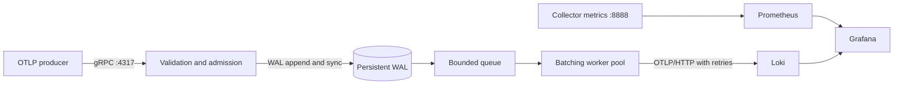

# Distributed Telemetry Collector

A Go collector for OpenTelemetry logs, built to study concurrency, backpressure,
and failure handling. It uses a custom write-ahead log (WAL) for crash recovery
and at-least-once delivery. The project is intended for local development and
testing; it does not include a production deployment or release pipeline.



## Run the full stack

Requirements: Docker Desktop with Compose. Native Go development uses Go 1.26.2.
The receiver uses official generated OTLP protocol packages; `protoc` and Buf
are not required to build this project.

```sh
make up
# Wait for Loki to report ready; initial startup can take about 30 seconds.
curl http://localhost:3100/ready
docker compose run --rm producer
```

The producer sends 100 logs through the collector. Open:

| Service | Address |
| --- | --- |
| Grafana dashboard | http://localhost:3000/d/telemetry-collector |
| Prometheus | http://localhost:9090 |
| Collector metrics | http://localhost:8888/metrics |
| Collector readiness | http://localhost:8888/readyz |
| Loki readiness | http://localhost:3100/ready |

Grafana has a provisioned dashboard and Loki/Prometheus data sources. Anonymous
viewing is enabled for local development; the optional admin login is `admin` /
`admin`. All published ports bind to localhost. Use Grafana Explore with the
Loki query `{service_name="telemetry-demo"}` to find sample logs.

To customize host ports or the Grafana admin password, copy `.env.example` to
`.env` before starting the stack. To generate more traffic:

```sh
docker compose run --rm producer -endpoint collector:4317 -count 10000 -batch 100 -interval 10ms
docker compose logs -f collector
make down
```

`make down` preserves named volumes. `docker compose down -v` deletes local
Loki, Prometheus, and Grafana data.

## Native development

Run Loki in Docker and the collector/producer on the host. Stop the full stack
first if its collector already occupies ports 4317 and 8888.

```sh
docker compose up -d loki
go mod download
make run
# In another terminal:
make produce
```

`make build` writes the collector, producer, load driver, and recovery benchmark
under `bin/`. Enable local pprof endpoints with `ENABLE_PPROF=true make run`; profile at
`http://localhost:8888/debug/pprof/`. If Docker cannot reach its engine, check
`docker context show` and select `docker context use desktop-linux`.

## Load measurements

`make load` runs the bounded OTLP/gRPC load driver against
`localhost:4317`. It reports accepted events/second, successful request P50/P95/P99
latency, `RESOURCE_EXHAUSTED` requests, and load-generator machine details as
JSON. It also samples queue depth, pending bytes, Go goroutines/heap, and process
resident memory from Prometheus every 50 ms. Set `-rate` to pace the offered
event rate; zero sends as fast as the bounded worker pool allows. Use
`-metrics-endpoint ''` to disable sampling. For example:

```sh
go run ./cmd/loadgen -endpoint localhost:4317 -events 20000 -batch 100 -workers 16 -payload-bytes 64 -rate 2000
```

The worker count and jobs channel are bounded. P99 is the OTLP request
acknowledgement latency; throughput counts accepted log events. Record collector
worker, queue, byte-budget, and WAL sync settings alongside each run.

The recovery tool creates a temporary WAL with unacknowledged one-event
requests. A child process syncs the records and exits without closing the WAL;
the parent then reports startup scan time and end-to-end in-process replay plus
WAL checkpoint time. Seeding is excluded. The replay benchmark uses an
immediate-success exporter, so it measures the collector queue/workers and WAL
acknowledgements without network/backend latency:

```sh
make recovery
go run ./cmd/recoverybench -events 10000 -sync-interval 2ms -sync-max-batch 32
```

On an Apple M2 Pro (darwin/arm64, Go 1.26.2, 10 CPUs, GOMAXPROCS=10), a 5-second
run accepted 10,000 events offered at 2,000 events/sec: 2,017.9 accepted
events/sec, 6.18 ms request P50, 7.49 ms P95, and 8.68 ms P99, with no
rejected requests. It used 100 events/request, 16 load workers, 64 body
bytes/event, and the collector defaults (4 export workers, queue capacity 128,
WAL sync every 2 ms or 32 records). Across 100 Prometheus samples, maximum
queue depth was 1 request, pending bytes 59,330, Go heap allocation 10.8 MB,
goroutines 23, and process resident memory 43.4 MB. This is a local baseline,
not a portable capacity claim.

An unpaced 50,000-event burst on the final collector accepted 16,000 events
and returned `RESOURCE_EXHAUSTED` for 340 requests, with no other RPC errors.
This verifies the configured queue and byte limits return overload to senders
rather than growing without bound. Treat burst throughput as a saturation
observation, not sustained capacity.

A 10,000-event recovery run seeded durable WAL records in a child process that
exited without closing the WAL, then reopened it in the parent. WAL scan and
reconstruction took 21.4 ms. Replaying all 10,000 through the collector's
worker pool and writing WAL checkpoints took 1.64 seconds (6,084 events/sec)
with an immediate-success test exporter, a 2 ms sync interval, and 32-record
group sync. The pipeline writes the batch's checkpoint records together and
waits for one sync. Real downstream delivery time depends on backend latency
and retries.

`make bench` runs the in-memory pipeline, pipeline-with-WAL, and grouped WAL
append/ack Go benchmarks with allocation reporting. A 1-second run on the same
Apple M2 Pro reported 1.75 µs/op for in-memory admission and 547 µs/op for
pipeline admission with WAL. A WAL microbenchmark with eight concurrent
appends measured 10.3 ms per append-plus-batched-checkpoint group, compared
with 43.1 ms when checkpointing those eight records individually. Go
microbenchmarks are not equivalent to end-to-end service throughput.

Capture a CPU profile of the WAL-backed admission benchmark with:

```sh
go test -run='^$' -bench=BenchmarkPipelineAdmissionWithWAL -benchtime=3s -cpuprofile=/tmp/dtc-phase3-cpu.out ./internal/collector
go tool pprof -top /tmp/dtc-phase3-cpu.out
```

The local profile's largest samples were system calls (33%), runtime condition
waits (25%), and GC object scanning (11%). This points to synchronization and
WAL I/O waits as the next profiling targets; it does not by itself establish a
single application-level hotspot.

## Delivery and resource behavior

- A successful OTLP response means the request was appended to the WAL. With
  `WAL_SYNC=true`, the collector waits for a filesystem sync that includes the
  append before acknowledging. Concurrent WAL records can share a sync, with a
  default maximum wait of 2 ms or until 32 records accumulate. With sync
  disabled, acknowledged data can be lost on a host or power failure.
  A crash after downstream export but before the WAL acknowledgement can replay
  a request and create duplicates, so delivery is at-least-once, not exactly-once.
  When one downstream batch succeeds, its WAL acknowledgement frames are
  appended together and covered by one sync.
- The queue bounds waiting requests. A separate byte budget covers queued and
  in-flight requests, including batching and retries. It measures encoded
  protobuf bytes, rather than Go heap usage; decoding, protobuf objects, and
  serialization buffers require additional memory.
- Full capacity returns `RESOURCE_EXHAUSTED` with `RetryInfo`. Invalid record
  limits/IDs return `INVALID_ARGUMENT`. The gRPC receive byte limit is enforced
  before the handler and returns `RESOURCE_EXHAUSTED` without retry advice.
- Workers combine up to `BATCH_SIZE` requests, flushing after `BATCH_WAIT`.
  A batch can contain at most `BATCH_SIZE * MAX_RECORDS_PER_REQUEST` records
  and approximately `BATCH_SIZE * MAX_REQUEST_BYTES` encoded bytes.
- Each failed HTTP attempt is counted. Transport errors and HTTP 429, 502,
  503, and 504 receive bounded exponential backoff with jitter. `Retry-After`
  is honored up to `RETRY_MAX`. Each attempt has an `EXPORT_TIMEOUT`.
  The exporter accepts standard OTLP HTTP 200 responses and Loki's HTTP 204
  full-success response.
- Permanent failures or exhausted retries drop the batch and increment
  `collector_dropped_total`. Partial downstream success is final: rejected
  records are counted as dropped, and the batch is not resent. An uncertain
  network result followed by a retry can produce duplicates.
- SIGINT/SIGTERM stops admission and drains accepted work within
  `SHUTDOWN_TIMEOUT`. On expiry, active exports are canceled, remaining records
  are counted as dropped, and the process exits with an error.
- Workers run concurrently; global delivery ordering is not guaranteed.
- `/healthz` indicates the admin server is alive. `/readyz` and the gRPC health
  service indicate admission readiness, independently of downstream health.
  These local endpoints use plaintext transport and no authentication.

## Collector configuration

Set environment variables for the native process, or edit the collector's
`environment` section in `compose.yaml`. `.env` controls Compose substitutions;
it does not automatically pass arbitrary variables into the container.

| Variable | Default | Meaning |
| --- | --- | --- |
| `GRPC_ADDR` | `127.0.0.1:4317` | OTLP/gRPC listener; Compose uses `:4317` |
| `HTTP_ADDR` | `127.0.0.1:8888` | Admin/metrics listener; Compose uses `:8888` |
| `EXPORT_ENDPOINT` | `http://localhost:3100/otlp/v1/logs` | Exact OTLP/HTTP logs URL |
| `QUEUE_CAPACITY` | `128` | Waiting requests |
| `WORKERS` | `4` | Concurrent batching/export workers |
| `BATCH_SIZE` | `8` | Maximum requests per export |
| `BATCH_WAIT` | `200ms` | Maximum batch assembly wait |
| `MAX_REQUEST_BYTES` | `1048576` | Maximum received protobuf message size |
| `MAX_RECORDS_PER_REQUEST` | `1000` | Maximum logs in an ingestion request |
| `MAX_PENDING_BYTES` | `67108864` | Admitted byte budget, including workers |
| `MAX_EXPORT_ATTEMPTS` | `5` | Total attempts per batch |
| `EXPORT_TIMEOUT` | `5s` | Timeout per HTTP attempt |
| `RETRY_INITIAL` | `100ms` | Initial retry backoff |
| `RETRY_MAX` | `2s` | Maximum retry sleep |
| `SHUTDOWN_TIMEOUT` | `15s` | Total gRPC shutdown and drain deadline |
| `ENABLE_PPROF` | `false` | Enable pprof on the admin listener |
| `WAL_DIR` | `./data/wal` | Directory containing the collector WAL |
| `WAL_SYNC` | `true` | Wait for WAL data and acknowledgement records to be synchronized before continuing |
| `WAL_SYNC_INTERVAL` | `2ms` | Maximum delay before syncing a group of WAL records; capped at `1s` |
| `WAL_SYNC_MAX_BATCH` | `32` | WAL records that trigger an immediate group sync |
| `KUBERNETES_ENABLED` | `false` | Enable periodic Kubernetes API collection |
| `KUBERNETES_NAMESPACE` | empty | Namespace to collect; empty means all namespaces |
| `KUBERNETES_KUBECONFIG` | empty | Kubeconfig path; empty uses in-cluster auth or client-go's default kubeconfig rules |
| `KUBERNETES_SCRAPE_INTERVAL` | `30s` | Time between Kubernetes API snapshots |
| `KUBERNETES_REQUEST_TIMEOUT` | `10s` | Deadline for listing pods and deployments per snapshot |

## Kubernetes metrics

Kubernetes collection is optional and disabled by default. When enabled, the
collector lists pods, deployments, and nodes through the Kubernetes API and
publishes the snapshot on the existing Prometheus `/metrics` endpoint. It reports pod
counts by namespace and phase, current cumulative restart counts per
namespace/pod/container, and desired/ready/available/updated replicas by
deployment, node Ready counts, and each node's allocatable CPU cores and memory
bytes. Allocatable values describe schedulable capacity, not live CPU or memory
usage.
Collection success, duration, last-success time, and errors (including forbidden access and
timeouts) are also exposed. A failed snapshot leaves the last good resource
snapshot in place and does not stop log ingestion.

The primary series are `collector_kubernetes_pods`,
`collector_kubernetes_container_restarts`, and
`collector_kubernetes_deployment_replicas`, `collector_kubernetes_nodes`, and
`collector_kubernetes_node_allocatable`.

For local development with your current kubeconfig:

```sh
KUBERNETES_ENABLED=true KUBERNETES_NAMESPACE=default make run
```

Set `KUBERNETES_KUBECONFIG=/path/to/config` to select a specific kubeconfig.
The live integration check ran the collector locally against a Minikube cluster
using the user's kubeconfig. The sample
[RBAC manifest](deploy/kubernetes/rbac.yaml) documents read-only list
permissions for pods, deployments, and nodes; it does not define a collector
workload. No collector deployment is provided or planned for this project.

## Verification

```sh
make fmt-check
make test
make race
make vet
go build ./...
make smoke
```

The GitHub Actions workflow runs formatting, static analysis, race-enabled
tests, and a build; it does not publish or deploy anything. The local smoke
check is optional and requires Docker, curl, and Python 3. It starts the stack,
sends 20 logs with a unique service name, queries Loki until all 20 are present,
and checks that the collector counted 20 successful exports. It leaves the
stack running for inspection. Tests also exercise WAL corruption and forced
process restart, saturation, in-flight admission limits, batching, partial
success, retries, gRPC limits, and graceful/forced shutdown.

The OTLP transport and retry policy follow the
[OTLP specification](https://opentelemetry.io/docs/specs/otlp/); Loki's setup
uses its [native OTLP ingestion support](https://grafana.com/docs/loki/latest/send-data/otel/).
See [ROADMAP.md](ROADMAP.md) for the durability and performance phases.
